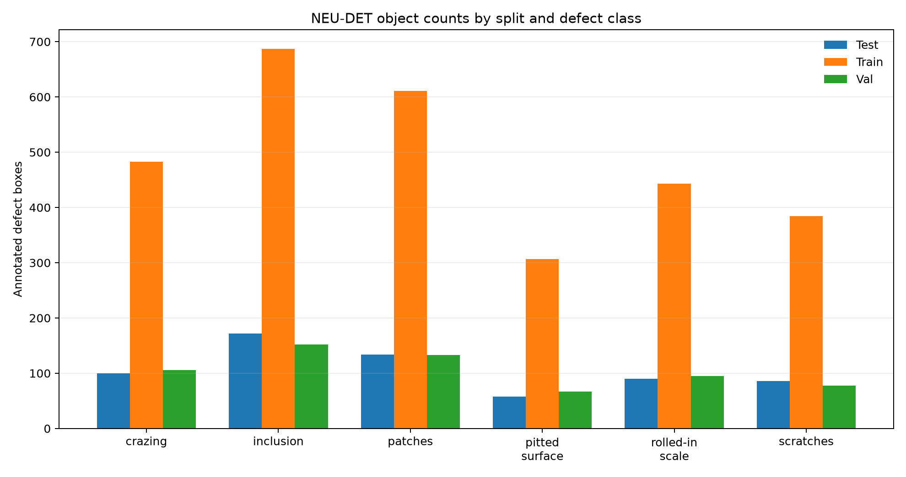
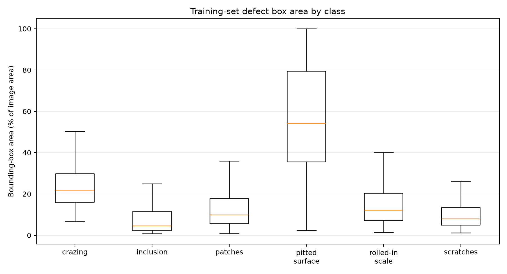
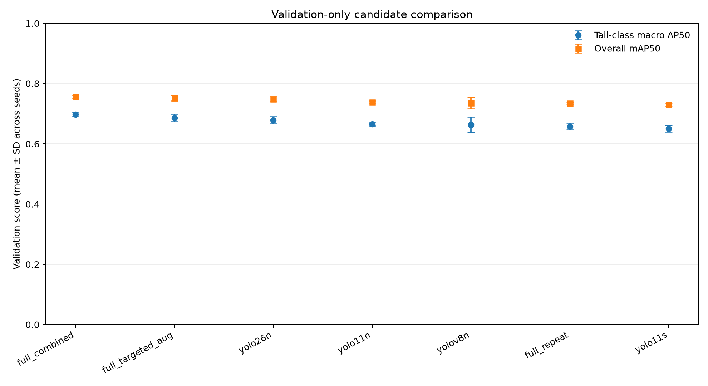
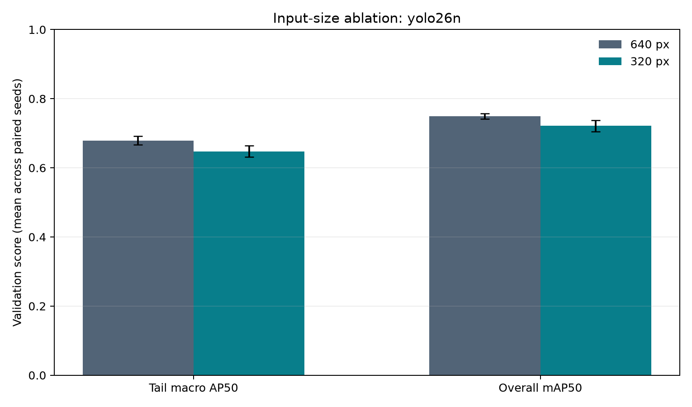
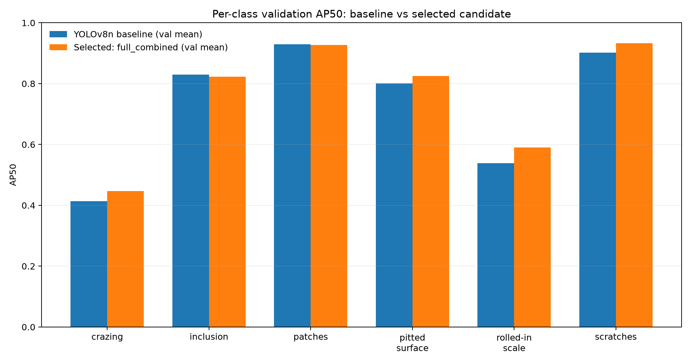
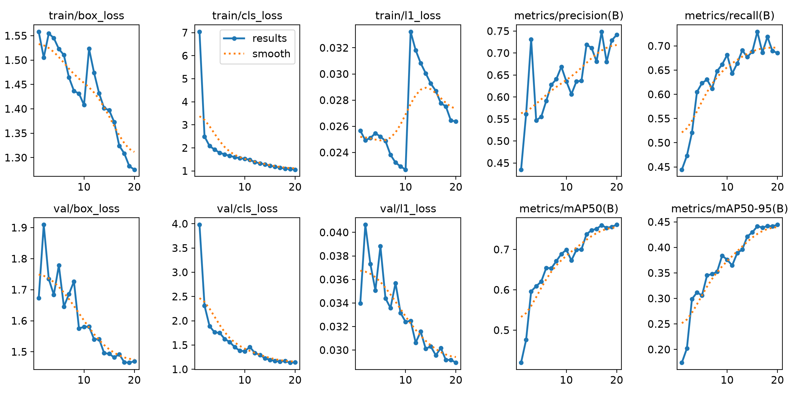
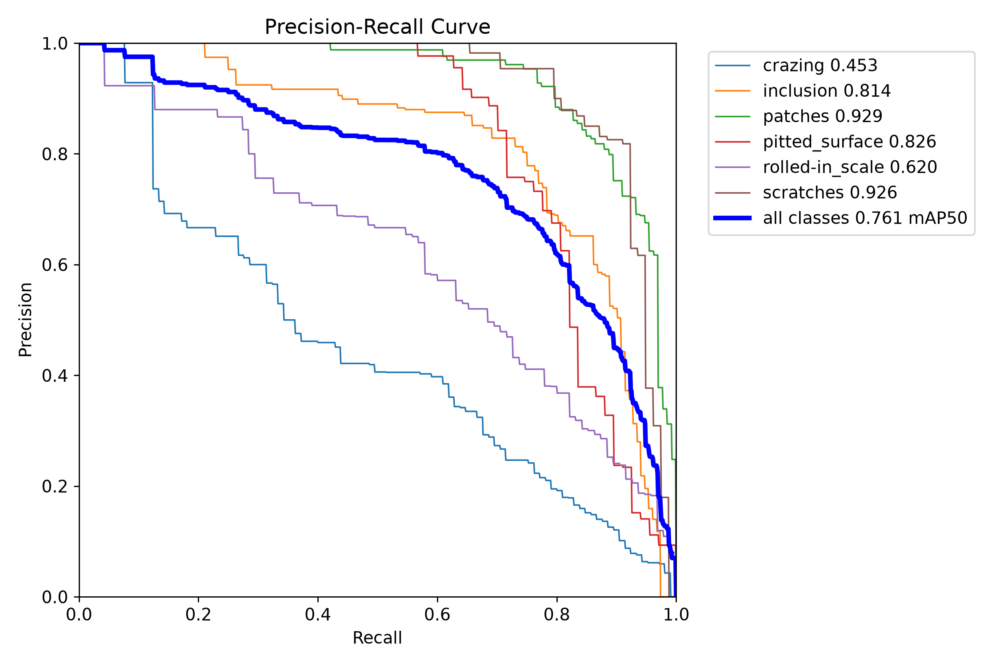
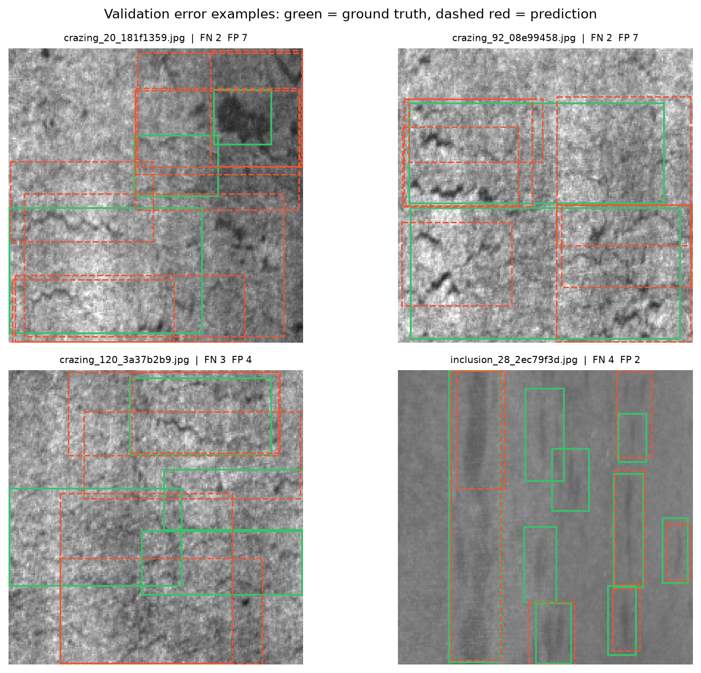
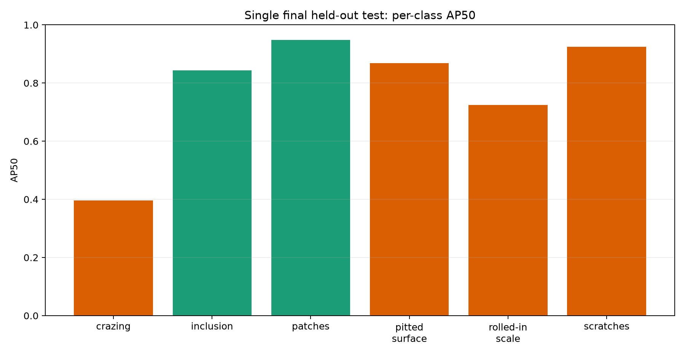
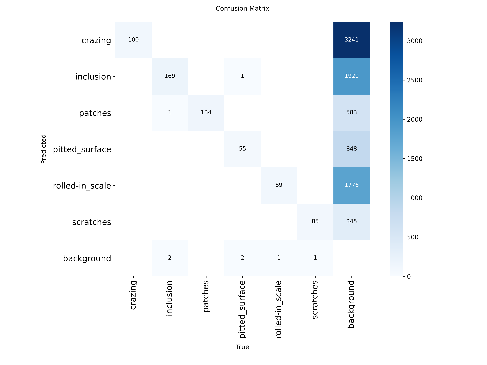

# Final Experimental Report on Class Imbalance and Steel Surface Defect Detection

**Project:** ATDL Final Year Project

**Generated:** 2026-11-19

**Dataset:** NEU-DET, six steel surface defect classes

## Abstract

This study evaluates COCO-pretrained YOLO detectors and class-imbalance interventions for six-class steel surface defect detection. The cleaned dataset contains 1,799 unique images and 4,183 unique boxes after removing 3 exact repeated label rows. The controlled Phase 8 benchmark used 1,257 training images, 266 validation images, and 276 test images. Four pretrained model families were compared across three random seeds; full-data repeat sampling, targeted augmentation, and combined training were then compared with matched image-exposure budgets. Candidate selection used validation only. The validation-selected group (full_combined) changed mean tail-class macro AP50 by +0.035 versus YOLOv8n across the three-seed groups. The final checkpoint was evaluated once on the test set after selection.

## 1 Research Objective and Hypotheses

The research question is whether imbalance-aware training can increase detection quality for the long-tail / error-prone defect categories while retaining overall detection performance. The pre-registered tail group follows the project's existing Phase 3–5 definition: `crazing`, `pitted_surface`, `rolled-in_scale`, and `scratches`. The primary validation endpoint is macro AP50 over those four classes; overall mAP50 is the tie-break and a safeguard metric. Secondary metrics are per-class precision/recall/F1, mAP50–95, training time, parameter count, checkpoint size, and per-image validation speed.

The project hypothesis is treated as a testable claim, not an assumed result. AP improvements are only reported when the saved validation/test results show them. Means and standard deviations across three seeds describe run variability; n=3 is not enough for strong inferential or deployment claims.

## 2 Dataset and Split Integrity

Phase 1 matched 1,800 raw images and removed one image from a duplicated exact-image group, leaving 1,799 unique image/annotation pairs and 4,186 box-label rows. A second audit found 3 exact repeated YOLO label rows across 3 images; Ultralytics removes these duplicate rows when it loads labels, and the Phase 8 operating-threshold evaluator applies the same deduplication. This leaves 4,183 unique box instances. The fixed grouped split contains 1,257 train, 266 validation, and 276 test images. Split rows below count annotation rows, not images.

| Split | Images | Annotated boxes |
|---|---:|---:|
| train | 1,257 | 2,915 |
| val | 266 | 631 |
| test | 276 | 640 |

### Training Boxes by Class

| Class | Train boxes |
|---|---:|
| crazing | 483 |
| inclusion | 687 |
| patches | 611 |
| pitted_surface | 307 |
| rolled-in_scale | 443 |
| scratches | 384 |





Box-area percentages are normalized to the source image area (the source images are 200×200). The box-area view describes object scale but does not by itself establish model difficulty.

Exact repeated annotation rows: `results/tables/exact_duplicate_yolo_label_rows.csv`. Historical Phase 4/5 distribution tables report source label rows. Phase 8 expanded treatment counts deduplicate exact box rows to match Ultralytics label loading.

Dataset archive SHA-256: `2ccaff85d88567c52708c2f9dc4dec10cff8650749df2984f03b38716998460f`. Fixed split manifest SHA-256: `bb25e67f5286333debe2267edcb4d5eddfee8a36373939e2c7907f95796dd944`. The raw archive and processed images are excluded from the Git repository; obtain the dataset from its cited source and verify it against the archive hash when available.

## 3 Experimental Design

The project runs from a raw-data audit and duplicate-group check, through annotation conversion and a fixed grouped train/validation/test split, then the full-data baseline, controlled imbalance-severity variants, single-seed moderate-subset methods, multi-seed pretrained-model transfer, full-data equal-exposure interventions, validation-only selection, one final test evaluation, and report generation. The Phase 8 notebook orchestrates the final stages; prior notebooks remain the record of the earlier phases.

### Pretrained Architecture Transfer

COCO-pretrained YOLOv8n, YOLO11n, YOLO26n, and YOLO11s were trained on the complete train split. Training used 640-pixel inputs, batch size 16, 50 requested epochs, optimizer `auto`, deterministic seeds 42/43/44, and the same validation split. The already completed YOLOv8n seed-42 baseline was reused; it was not retrained. Model family selection was based on validation mean tail-class AP50, then validation overall mAP50.

| Model | Seeds | Tail macro AP50 | Overall mAP50 | mAP50–95 | Params | Time / run (s) |
|---|---:|---:|---:|---:|---:|---:|
| yolov8n | 3 | 0.664 ± 0.026 | 0.736 ± 0.019 | 0.424 ± 0.010 | 3,157,200 | 226.0 |
| yolo11n | 3 | 0.665 ± 0.005 | 0.738 ± 0.005 | 0.434 ± 0.004 | 2,606,098 | 241.4 |
| yolo26n | 3 | 0.679 ± 0.012 | 0.749 ± 0.008 | 0.439 ± 0.000 | 2,536,316 | 284.8 |
| yolo11s | 3 | 0.651 ± 0.010 | 0.730 ± 0.006 | 0.426 ± 0.006 | 9,430,114 | 418.3 |



### Input-size ablation for the selected model family

The 640-pixel transfer winner (`yolo26n`) was then compared with the same pretrained model at 320 pixels using paired seeds 42/43/44. Split, optimizer, batch, epoch cap, and all other training settings stayed fixed. This ablation is reported separately and was not added to the architecture/intervention candidate ranking. The 320-pixel input changed tail macro AP50 by -0.031 ± 0.006 and mAP50 by -0.027 ± 0.013; inference time changed by -1.11 ms/image.

| Input size | Seeds | Tail macro AP50 | Overall mAP50 | mAP50–95 | Inference (ms/image) | Train time (s) |
|---:|---:|---:|---:|---:|---:|---:|
| 640 | 3 | 0.679 ± 0.012 | 0.749 ± 0.008 | 0.439 ± 0.000 | 1.56 ± 0.02 | 284.8 |
| 320 | 3 | 0.648 ± 0.016 | 0.722 ± 0.016 | 0.419 ± 0.005 | 0.45 ± 0.02 | 179.2 |



### Full Data Imbalance Interventions

The selected architecture was fixed before intervention training. Each treatment restarts from the same COCO-pretrained checkpoint for that architecture, rather than continuing from a validation-selected fine-tuned checkpoint. Every treatment includes all 1,257 original training images; validation and test are never augmented or resampled. Repeat sampling uses square-root inverse box-instance frequency, with the per-image factor equal to the maximum factor among tail classes present and deterministic stochastic rounding. Targeted augmentation adds two transforms to each training image with a tail-class object: horizontal flip with brightness 0.92 and 90-degree clockwise rotation with brightness 1.08. Bounding boxes are transformed analytically. The combined method applies both operations.

To control optimization exposure, all interventions target 62,850 image presentations (1,257 × 50 baseline presentations). Epoch count is rounded from this target using the expanded manifest size; actual planned exposures are recorded per run. Early stopping is disabled by setting patience above the epoch count. The baseline was the standard Phase 3 schedule; this exposure matching is for the intervention contrasts.

| Treatment | Seeds | Tail macro AP50 | Overall mAP50 | mAP50–95 | Epochs | Expanded train images |
|---|---:|---:|---:|---:|---:|---:|
| full_repeat | 3 | 0.658 ± 0.011 | 0.735 ± 0.004 | 0.434 ± 0.007 | 41 | 1,543 |
| full_targeted_aug | 3 | 0.687 ± 0.013 | 0.752 ± 0.009 | 0.436 ± 0.006 | 21 | 2,937 |
| full_combined | 3 | 0.698 ± 0.008 | 0.757 ± 0.005 | 0.440 ± 0.004 | 20 | 3,223 |

### Candidate Selection and Test

The final candidate group was selected among all complete three-seed architecture and intervention groups using mean validation tail macro AP50, with overall validation mAP50 as the tie-break. One seed-specific checkpoint was then fixed from that group using validation tail AP50 followed by overall mAP50. The Phase 8 selection scripts did not read test metrics. The existing test split had already been used for the Phase 6 YOLOv8n baseline evaluation before this extension; therefore, the new candidate's one-pass test results are descriptive and are not a fully blind independent comparison. A fresh, genuinely untouched holdout would require a new dataset or a complete retraining protocol under a newly reserved split.

## 4 Results

### Historical Phase 5 Comparison

These seed-42 results are useful context for the original imbalance-severity and method experiments. Train presentations differ across rows, and methods use the moderate subset, so this table is exploratory rather than a causal or matched-exposure comparison.

| Phase 5 condition | Train presentations | Tail macro AP50 | mAP50 | mAP50–95 | Macro F1 |
|---|---:|---:|---:|---:|---:|
| E1_imbalanced_standard | 808 | 0.588 | 0.685 | 0.386 | 0.624 |
| E2_repeat_factor | 1459 | 0.601 | 0.685 | 0.382 | 0.634 |
| E3_targeted_augmentation | 2056 | 0.607 | 0.687 | 0.383 | 0.646 |
| E4_combined | 2707 | 0.604 | 0.690 | 0.374 | 0.667 |
| E1_mild_standard | 1109 | 0.672 | 0.742 | 0.419 | 0.685 |
| E1_severe_standard | 597 | 0.569 | 0.665 | 0.372 | 0.575 |

### Overall Validation Comparison

All group-level metrics below are mean ± standard deviation over the three seeds. Primary accuracy and tail-operating metrics:

| Candidate | Seeds | Tail macro AP50 | mAP50 | mAP50–95 | Tail recall | Tail F1 |
|---|---:|---:|---:|---:|---:|---:|
| full_combined | 3 | 0.698 ± 0.008 | 0.757 ± 0.005 | 0.440 ± 0.004 | 0.651 ± 0.027 | 0.649 ± 0.005 |
| full_targeted_aug | 3 | 0.687 ± 0.013 | 0.752 ± 0.009 | 0.436 ± 0.006 | 0.648 ± 0.029 | 0.638 ± 0.005 |
| yolo26n | 3 | 0.679 ± 0.012 | 0.749 ± 0.008 | 0.439 ± 0.000 | 0.615 ± 0.026 | 0.626 ± 0.008 |
| yolo11n | 3 | 0.665 ± 0.005 | 0.738 ± 0.005 | 0.434 ± 0.004 | 0.634 ± 0.027 | 0.616 ± 0.018 |
| yolov8n | 3 | 0.664 ± 0.026 | 0.736 ± 0.019 | 0.424 ± 0.010 | 0.609 ± 0.017 | 0.606 ± 0.009 |
| full_repeat | 3 | 0.658 ± 0.011 | 0.735 ± 0.004 | 0.434 ± 0.007 | 0.640 ± 0.007 | 0.621 ± 0.017 |
| yolo11s | 3 | 0.651 ± 0.010 | 0.730 ± 0.006 | 0.426 ± 0.006 | 0.621 ± 0.031 | 0.604 ± 0.002 |

Overall detection operating metrics and validation inference timing:

| Candidate | Overall precision | Overall recall | Global F1 | Macro F1 | Inference ms/image |
|---|---:|---:|---:|---:|---:|
| full_combined | 0.697 ± 0.035 | 0.713 ± 0.023 | 0.704 ± 0.006 | 0.699 ± 0.003 | 1.56 ± 0.01 |
| full_targeted_aug | 0.683 ± 0.035 | 0.712 ± 0.028 | 0.696 ± 0.009 | 0.692 ± 0.007 | 1.56 ± 0.01 |
| yolo26n | 0.706 ± 0.021 | 0.690 ± 0.025 | 0.697 ± 0.004 | 0.690 ± 0.009 | 1.56 ± 0.02 |
| yolo11n | 0.666 ± 0.030 | 0.706 ± 0.018 | 0.685 ± 0.011 | 0.677 ± 0.011 | 1.66 ± 0.01 |
| yolov8n | 0.685 ± 0.019 | 0.688 ± 0.010 | 0.686 ± 0.009 | 0.675 ± 0.007 | 1.64 ± 0.01 |
| full_repeat | 0.679 ± 0.021 | 0.708 ± 0.004 | 0.693 ± 0.011 | 0.689 ± 0.012 | 1.57 ± 0.02 |
| yolo11s | 0.664 ± 0.038 | 0.698 ± 0.027 | 0.680 ± 0.008 | 0.672 ± 0.006 | 3.67 ± 0.00 |

Model-size and training-cost metrics:

| Candidate | Parameters | Checkpoint size (MB) | Mean training time (s) |
|---|---:|---:|---:|
| full_combined | 2,536,316 | 5.5 | 267.5 ± 0.8 |
| full_targeted_aug | 2,536,316 | 5.5 | 257.4 ± 1.2 |
| yolo26n | 2,536,316 | 5.5 | 284.8 ± 0.3 |
| yolo11n | 2,606,098 | 5.5 | 241.4 ± 1.0 |
| yolov8n | 3,157,200 | 6.5 | 226.0 ± 1.0 |
| full_repeat | 2,536,316 | 5.5 | 277.4 ± 0.2 |
| yolo11s | 9,430,114 | 19.2 | 418.3 ± 0.5 |







### Per Class Results for the Selected Checkpoint

The validation AP50 column below is the specific seed selected for the final test. Test AP50 comes from the Ultralytics validation protocol at its confidence sweep. The second table reports per-class operating metrics at thresholds selected on validation predictions by maximizing F1 at IoU 0.50, then applied unchanged to test.

| Class | Train boxes | Baseline val AP50 | Selected val AP50 | Final test AP50 |
|---|---:|---:|---:|---:|
| crazing | 483 | 0.466 | 0.453 | 0.396 |
| inclusion | 687 | 0.857 | 0.814 | 0.843 |
| patches | 611 | 0.916 | 0.929 | 0.948 |
| pitted_surface | 307 | 0.833 | 0.826 | 0.869 |
| rolled-in_scale | 443 | 0.568 | 0.620 | 0.725 |
| scratches | 384 | 0.906 | 0.926 | 0.925 |

| Class | Confidence threshold (validation) | Test precision | Test recall | Test F1 |
|---|---:|---:|---:|---:|
| crazing | 0.14 | 0.341 | 0.590 | 0.432 |
| inclusion | 0.33 | 0.782 | 0.773 | 0.778 |
| patches | 0.54 | 0.954 | 0.776 | 0.856 |
| pitted_surface | 0.35 | 0.870 | 0.810 | 0.839 |
| rolled-in_scale | 0.31 | 0.727 | 0.622 | 0.671 |
| scratches | 0.23 | 0.812 | 0.907 | 0.857 |

### Validation Error Analysis

The following examples come from validation predictions only. Green boxes show ground truth; dashed red boxes show predictions after applying the confidence thresholds selected on validation. The complete ranked file list is `results/comprehensive/validation_error_cases.csv`. These images illustrate errors; they are not a substitute for the aggregate metrics.







### Final Test Summary

Selected group: **full_combined**, seed **42**. Test precision = **0.729**, recall = **0.745**, global F1 = **0.737**, mAP50 = **0.784**, and mAP50–95 = **0.471**. Test macro AP50 for the four tail classes = **0.729**, and tail macro operating-point F1 = **0.700**. The test split contained 276 images in the single final evaluation; validation-reported inference speed was 1.93 ms/image on the recorded GPU.

Historical YOLOv8n seed-42 test record: mAP50 = 0.775, mAP50–95 = 0.451, global F1 = 0.719. This record predates the Phase 8 model search. The Phase 8 selection itself is validation-only, but a reader already had access to the earlier baseline test result, so any baseline-to-finalist test difference is descriptive.

## 5 Interpretation and Findings

1. **Best validation candidate:** full_combined ranked first under the validation-only objective at tail macro AP50 0.698 ± 0.008; overall mAP50 was 0.757 ± 0.005.
2. **Change versus the multi-seed YOLOv8n baseline:** The validation-selected group (full_combined) changed mean tail-class macro AP50 by +0.035 versus YOLOv8n across the three-seed groups.
3. **Tail-class spread:** per-class results remain important because a macro score can hide a class-specific regression. In the original YOLOv8n validation record, `crazing` AP50 was 0.466 and `rolled-in_scale` AP50 was 0.568; compare these with each selected candidate's per-class table and plots.
4. **Legacy Phase 5 evidence:** the Phase 5 variants were single-seed and trained from a reduced 808-image moderate subset; repeated samples and augmentations also changed epoch-level exposure. Their results remain exploratory and should not be treated as a controlled proof that imbalance handling beats full-data training.
5. **Generalization:** the final test evaluation is one selected checkpoint on one fixed split. Three training seeds, a single dataset, and one test set do not establish statistical significance or production readiness.

## 6 Study Limits

- The NEU-DET dataset is small and images are 200×200; high-resolution deployment behavior and domain shift are not measured here.
- Three seeds improve on a single run but produce wide uncertainty estimates; no confirmatory power analysis or hypothesis test is claimed.
- The transfer benchmark varies model family and capacity together. Results answer which tested checkpoint performed best under this fixed budget, not which architecture mechanism caused the difference.
- Offline flips and right-angle rotation are plausible texture-preserving transforms but may not represent every steel-inspection camera orientation or process.
- Thresholds were selected from validation detections. The reported operating point is useful for error analysis but will require recalibration for different cameras, prevalence, or costs.
- The previously completed baseline test result used this same test split. Although Phase 8 selection is validation-only and the new candidate is tested once, the holdout is not fully blind across the entire project history; treat comparisons as descriptive.

## 7 Training-Data Distribution Appendix

Image counts indicate the number of image presentations containing each class; an image with multiple labels contributes to multiple rows. Historical Phase 4/5 box counts are source annotation rows; three exact repeated rows are removed by Ultralytics during loading. Phase 5 methods operate on a reduced moderate subset and have unmatched exposure, while Phase 8 keeps all originals and reports expanded box counts after exact-row deduplication.

### Phase 4 severity profiles

| Phase 4 profile | Class | Train images with class | Train boxes |
|---|---|---:|---:|
| mild | crazing | 187 | 426 |
| mild | inclusion | 267 | 687 |
| mild | patches | 239 | 611 |
| mild | pitted_surface | 211 | 307 |
| mild | rolled-in_scale | 161 | 340 |
| mild | scratches | 134 | 248 |
| moderate | crazing | 121 | 275 |
| moderate | inclusion | 267 | 687 |
| moderate | patches | 214 | 553 |
| moderate | pitted_surface | 161 | 233 |
| moderate | rolled-in_scale | 81 | 172 |
| moderate | scratches | 54 | 103 |
| severe | crazing | 67 | 151 |
| severe | inclusion | 267 | 687 |
| severe | patches | 174 | 443 |
| severe | pitted_surface | 107 | 159 |
| severe | rolled-in_scale | 41 | 89 |
| severe | scratches | 31 | 60 |

### Phase 5 moderate-subset methods

| Phase 5 experiment | Class | Train images with class | Train boxes | Total train presentations |
|---|---|---:|---:|---:|
| E1_imbalanced_standard | crazing | 121 | 275 | 808 |
| E1_imbalanced_standard | inclusion | 267 | 687 | 808 |
| E1_imbalanced_standard | patches | 214 | 553 | 808 |
| E1_imbalanced_standard | pitted_surface | 161 | 233 | 808 |
| E1_imbalanced_standard | rolled-in_scale | 81 | 172 | 808 |
| E1_imbalanced_standard | scratches | 54 | 103 | 808 |
| E2_repeat_factor | crazing | 242 | 550 | 1,459 |
| E2_repeat_factor | inclusion | 353 | 814 | 1,459 |
| E2_repeat_factor | patches | 429 | 1,107 | 1,459 |
| E2_repeat_factor | pitted_surface | 323 | 467 | 1,459 |
| E2_repeat_factor | rolled-in_scale | 162 | 344 | 1,459 |
| E2_repeat_factor | scratches | 162 | 309 | 1,459 |
| E3_targeted_augmentation | crazing | 484 | 1,100 | 2,056 |
| E3_targeted_augmentation | inclusion | 363 | 816 | 2,056 |
| E3_targeted_augmentation | patches | 313 | 694 | 2,056 |
| E3_targeted_augmentation | pitted_surface | 644 | 932 | 2,056 |
| E3_targeted_augmentation | rolled-in_scale | 324 | 688 | 2,056 |
| E3_targeted_augmentation | scratches | 216 | 412 | 2,056 |
| E4_combined | crazing | 605 | 1,375 | 2,707 |
| E4_combined | inclusion | 449 | 943 | 2,707 |
| E4_combined | patches | 528 | 1,248 | 2,707 |
| E4_combined | pitted_surface | 806 | 1,166 | 2,707 |
| E4_combined | rolled-in_scale | 405 | 860 | 2,707 |
| E4_combined | scratches | 324 | 618 | 2,707 |

### Phase 8 full-data treatments

| Phase 8 treatment | Class | Train presentations with class | Train boxes presented | Total train presentations/epoch |
|---|---|---:|---:|---:|
| full_repeat | crazing | 257 | 593 | 1,543 |
| full_repeat | inclusion | 277 | 697 | 1,543 |
| full_repeat | patches | 257 | 637 | 1,543 |
| full_repeat | pitted_surface | 321 | 476 | 1,543 |
| full_repeat | rolled-in_scale | 269 | 561 | 1,543 |
| full_repeat | scratches | 281 | 505 | 1,543 |
| full_targeted_aug | crazing | 630 | 1,449 | 2,937 |
| full_targeted_aug | inclusion | 331 | 772 | 2,937 |
| full_targeted_aug | patches | 305 | 704 | 2,937 |
| full_targeted_aug | pitted_surface | 633 | 921 | 2,937 |
| full_targeted_aug | rolled-in_scale | 630 | 1,329 | 2,937 |
| full_targeted_aug | scratches | 630 | 1,152 | 2,937 |
| full_combined | crazing | 677 | 1,559 | 3,223 |
| full_combined | inclusion | 341 | 783 | 3,223 |
| full_combined | patches | 323 | 731 | 3,223 |
| full_combined | pitted_surface | 743 | 1,090 | 3,223 |
| full_combined | rolled-in_scale | 689 | 1,447 | 3,223 |
| full_combined | scratches | 701 | 1,273 | 3,223 |

## 8 Reproducibility and Project Workflow

Run from the repository root using the project `.venv` Jupyter kernel or `.venv/bin/python`:

```bash
.venv/bin/python -m src.atdl.run_comprehensive_study --stage architectures
.venv/bin/python -m src.atdl.run_resolution_ablation
.venv/bin/python -m src.atdl.run_full_data_interventions
.venv/bin/python -m src.atdl.finalize_evaluation --select-only
.venv/bin/python -m src.atdl.finalize_evaluation
.venv/bin/python -m src.atdl.build_final_report
```

Main artifacts:
- `notebook/atdl_phase8_comprehensive_evaluation.ipynb` — VS Code/Jupyter end-to-end runbook.
- `src/atdl/run_comprehensive_study.py` — pretrained model comparison.
- `src/atdl/run_full_data_interventions.py` — generated treatment datasets and equal-exposure training.
- `src/atdl/finalize_evaluation.py` — validation selection, single test evaluation, threshold/error analysis, and figures.
- `results/comprehensive/` — run JSON, CSV summaries, test metrics, selection record, and plots.
- `outputs/checkpoints/phase8/` — best checkpoints and run configuration signatures.

## References

1. Lv et al., ‘Deep Metallic Surface Defect Detection: The New Benchmark and Detection Network,’ *Sensors*, 2020. [https://doi.org/10.3390/s20061562](https://doi.org/10.3390/s20061562)
2. ‘Comparison of Pre-Trained YOLO Models on Steel Surface Defects Detector Based on Transfer Learning with GPU-Based Embedded Devices,’ *Sensors*, 2022. [https://www.mdpi.com/1424-8220/22/24/9926](https://www.mdpi.com/1424-8220/22/24/9926)
3. Ultralytics, official model and detection task documentation. [https://docs.ultralytics.com/models/](https://docs.ultralytics.com/models/) · [https://docs.ultralytics.com/tasks/detect/](https://docs.ultralytics.com/tasks/detect/)
4. Yaman et al., ‘Instance and Repeat Factor Sampling for Long-Tailed Object Detection,’ arXiv:2305.08069, 2023. [https://arxiv.org/abs/2305.08069](https://arxiv.org/abs/2305.08069)

---
Generated from versioned result JSON and CSV files. If the training matrix is rerun, rebuild this report and the slide deck so they match the current artifacts.
